<table>
  <tr>
    <td align="center"><strong>25+ years</strong> production infrastructure</td>
    <td align="center"><strong>DevOps</strong> automation-first delivery</td>
    <td align="center"><strong>Network security</strong> BGP, RTBH, threat feeds</td>
    <td align="center"><strong>AI</strong> ops, reporting, tooling</td>
  </tr>
</table>

> I help turn complex infrastructure into platforms that are easier to operate, easier to recover, and easier for teams to trust.

## I Build Infrastructure That Keeps Its Promises

I'm Simon, a UK-based Senior Linux, DevOps, and Platform Engineer with 25+ years of experience building, fixing, automating, and improving production systems.

My work sits where infrastructure, automation, networking, storage, security, and pragmatic software engineering meet. I have spent my career keeping real platforms alive: ISP environments, build systems, Docker and Kubernetes estates, virtualisation platforms, storage, DNS, mail, routing, monitoring, backup, and the operational tooling around them.

These days I am especially interested in the layer between operations and software: the Go and Python tools, CI/CD workflows, Ansible roles, Terraform plans, AI-assisted workflows, and small internal services that turn repeated human effort into reliable platform behaviour.

I am also actively exploring AI-assisted operations: not hype for its own sake, but useful automation, summarisation, reporting, developer support, and internal tools that help engineers understand systems faster and make better decisions.

  

## What I Bring

  

## Selected Public Work

A few public examples of the kind of tooling I like to build: practical, operator-facing, and designed to solve specific production problems cleanly.

  
  
  
  
  
  

Each card opens its repository. Homebrew taps for the tools above:

## Core Toolbox

  

## Engineering Style

  

## GitHub

This profile is a public slice of the work I care about: infrastructure tools, operational notes, experiments, and production-minded utilities from years spent close to the metal.

[GitHub profile](https://github.com/soakes) |
[Public repositories](https://github.com/soakes?tab=repositories)

---

<strong>Useful infrastructure. Clear automation. Calm production.</strong>

